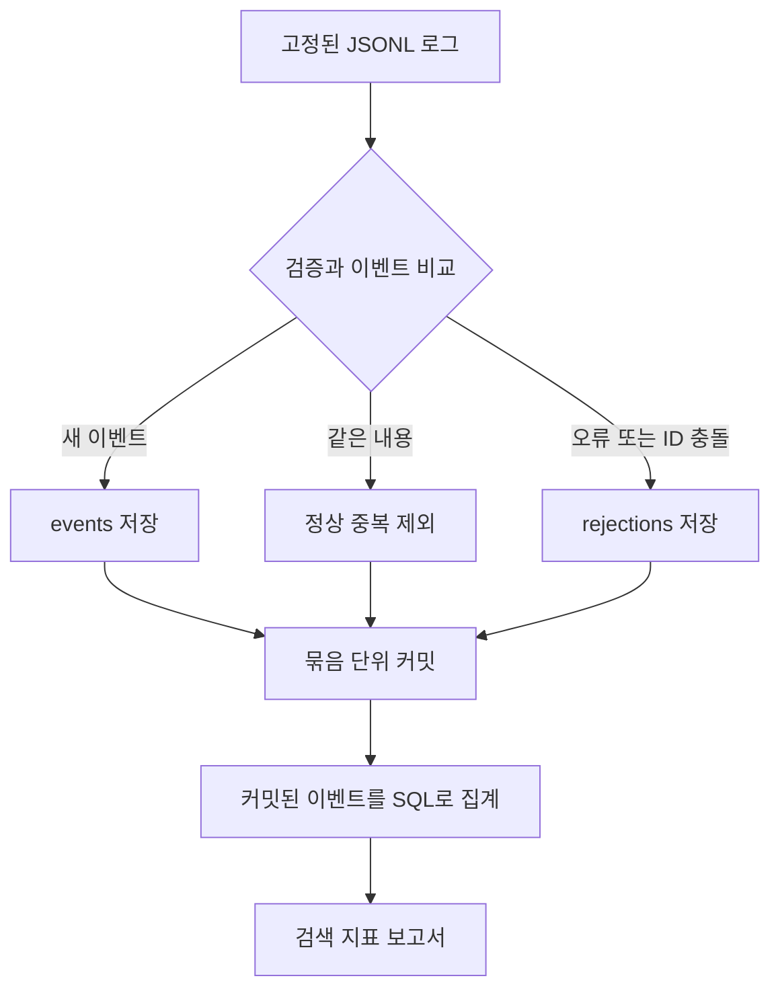

# ReplayLog

[](https://github.com/jinseo0702/replaylog/actions/workflows/tests.yml)

검색 로그를 재처리하거나 수집 프로세스가 종료돼도 검색 건수와 서버 오류율이 중복 집계되지 않도록 만드는 Python/SQLite 프로젝트입니다. 같은 이벤트 ID에 다른 내용이 들어오면 기존 값을 유지하고 충돌 기록을 남깁니다.

고정된 파일, 단일 수집 프로세스, 로컬 DB에서 재실행과 복구의 정확성을 검증합니다. 기대 결과와 테스트를 먼저 커밋하고, 구현이 없는 상태의 실패를 확인한 뒤 코드를 추가했습니다.

## 해결하는 문제

수집 도중 종료된 프로그램은 같은 로그를 다시 받을 수 있습니다. 읽을 때마다 지표 카운터를 더하면 이미 처리한 이벤트까지 다시 집계됩니다. 진행 위치를 별도로 저장해도 이벤트 저장과 위치 갱신이 어긋나면 누락 또는 중복이 생깁니다.

ReplayLog는 유효 이벤트를 DB에 한 번만 저장하고, 지표는 저장된 이벤트에서 조회합니다. 진행 위치를 따로 저장하지 않고 원본을 다시 읽는 비용을 받아들여 복구 상태를 단순하게 유지합니다.



## 실행

Python 3.10 이상과 Python의 sqlite3 모듈을 사용합니다. 외부 패키지 설치 없이 저장소 루트에서 실행합니다. 로컬 검증은 Python 3.10.12와 3.13.4에서 수행했습니다.

```text
git clone https://github.com/jinseo0702/replaylog.git
cd replaylog
python tools/demo.py
```

Linux에서 python 명령이 없으면 python3를 사용합니다. 데모는 임시 DB에 예제를 두 번 수집하고 work/demo에 보고서, 오류 기록, 실행별 요약을 남깁니다.

개별 명령은 다음과 같습니다. 먼저 work 디렉터리를 만들어 주세요.

```text
python -m replaylog ingest fixtures/golden-12.jsonl --db work/events.db --batch-size 100
python -m replaylog report --db work/events.db --out work/report.json
python -m replaylog rejects --db work/events.db --out work/rejections.jsonl
```

입력은 UTF-8 JSONL입니다. UTC 시각 형식을 고정하고 필드와 자료형을 검증합니다.

```json
{"service":"web","event_id":"e001","event_time":"2026-10-14T00:00:00Z","query":"날씨","status_code":200}
```

## 처리 규칙

| 상황 | 동작 |
| --- | --- |
| 새로운 (service, event_id) | 유효 이벤트 저장 |
| 같은 키와 같은 내용 | 정상 중복 제외 |
| 같은 키와 다른 내용 | 기존 이벤트 유지, id_conflict 기록 |
| 형식 또는 값 오류 | 줄 번호, 이유, 원문 기록 후 계속 처리 |
| 수집 중 프로세스 종료 | 같은 파일을 다시 읽고 저장된 키로 중복 구분 |
| DB 오류 또는 파일 접근 오류 | 실패로 종료, 이전에 커밋된 배치 유지 |

오류 기록도 파일 내용의 SHA-256과 줄 번호로 식별하므로 같은 입력을 재처리해도 동일 오류 기록이 늘어나지 않습니다. 실행별 중복 발견 건수는 달라질 수 있지만 서비스 지표는 유지돼야 합니다.

## 검증 결과

2026년 10월 14일 로컬 검증 결과입니다. 전체 실행 기록은 [검증 문서](docs/VERIFICATION.md)에 연결돼 있습니다.

| 환경과 실험 | 실제 결과 |
| --- | --- |
| Linux WSL2, Python 3.10.12, SQLite 3.37.2 | 30개 테스트 통과 |
| Windows 11, Python 3.13.4, SQLite 3.49.1 | 일반 테스트 28개 통과, POSIX 전용 2개 제외 |
| 커밋 직전 SIGKILL 후 재실행 | 3회 모두 정상 완료 결과와 일치 |
| 커밋 직후 SIGKILL 후 재실행 | 3회 모두 정상 완료 결과와 일치 |
| 동일 파일 반복 처리 | 유효 이벤트와 오류 기록, 서비스 지표 유지 |
| 출력 경로가 DB 경로와 같음 | 실패로 종료하고 DB 보존 |

12줄 예제의 실제 결과는 유효 이벤트 5개, 정상 중복 2개, 형식·값 오류 4개, ID 충돌 1개입니다. 서버 오류는 2개이며 오류율은 40%입니다. 같은 파일을 다시 수집하면 새 이벤트 0개, 정상 중복 7개가 되지만 보고서와 오류 기록은 유지됩니다.

[예상 결과](fixtures/expected-report.json)와 [실제 데모 결과](examples/demo-results/report.json)를 별도로 보관합니다.

## 테스트 먼저 개발한 기록

1. 입력 계약과 기대 결과, 수집·재실행·강제 종료 테스트를 먼저 작성했습니다.
2. 구현이 없는 상태의 실패를 [첫 실패 로그](evidence/01-red-linux.txt)로 저장하고 커밋했습니다.
3. 구현을 추가해 [28개 테스트 통과](evidence/02-green-linux.txt)를 확인했습니다.
4. 출력이 DB를 덮어쓰는 경우를 검사하는 테스트를 추가해 [2개 실패](evidence/03-safety-red-linux.txt)를 재현했습니다.
5. 보호 로직을 추가하고 [최종 30개 통과](evidence/04-final-linux.txt)를 확인했습니다.

[GitHub 커밋 이력](https://github.com/jinseo0702/replaylog/commits/main)에 테스트와 구현이 분리돼 있습니다. 기대 결과는 애플리케이션의 집계 함수로 만들지 않고 작은 예제에서 먼저 정했습니다.

```text
python -m unittest discover -s tests -v
```

Linux에서는 실제 SIGKILL 실험까지 수행합니다. Windows에서는 POSIX 전용 두 테스트를 제외합니다. Windows에서 Ubuntu-22.04 WSL이 설치돼 있으면 다음 명령으로 동일 테스트를 Linux에서 실행할 수 있습니다.

```text
python tools/run_linux_tests.py --stage final
```

## 설계 판단과 한계

설계 선택과 받아들인 비용은 [설계 판단 기록](docs/DECISIONS.md)에 있습니다. 특히 DB 고유 키와 메모리 중복 검사, 조회 집계와 별도 카운터, 전체 재처리와 진행 위치 저장을 비교했습니다. 구현하거나 측정하지 않은 대안은 후보로 구분합니다.

v1은 순차적으로 처리하는 고정된 파일과 단일 수집 프로세스를 대상으로 합니다. ID 충돌에서는 먼저 도착한 값을 유지하므로 서로 다른 내용의 도착 순서를 바꾸면 결과가 달라질 수 있습니다. 다중 수집자, 실시간 스트리밍, 전원 차단, 디스크 고장, 분산 시스템의 exactly-once를 검증한 프로젝트로 주장하지 않습니다.

## 기여 범위

사용자는 해결할 문제와 테스트 먼저 개발하는 방식을 정하고 설계 방향을 검토했습니다. AI 에이전트는 설계 초안, 기대 예제, 테스트, 구현, 실행 검증, 문서 정리를 수행했습니다. 코드 작성과 설계 검토, 실제 실행 결과를 구분해 공개합니다.

- [상세 설계](docs/DESIGN.md)
- [설계 판단](docs/DECISIONS.md)
- [검증 기록](docs/VERIFICATION.md)
- [실제 실행 예제](examples/demo-results)
