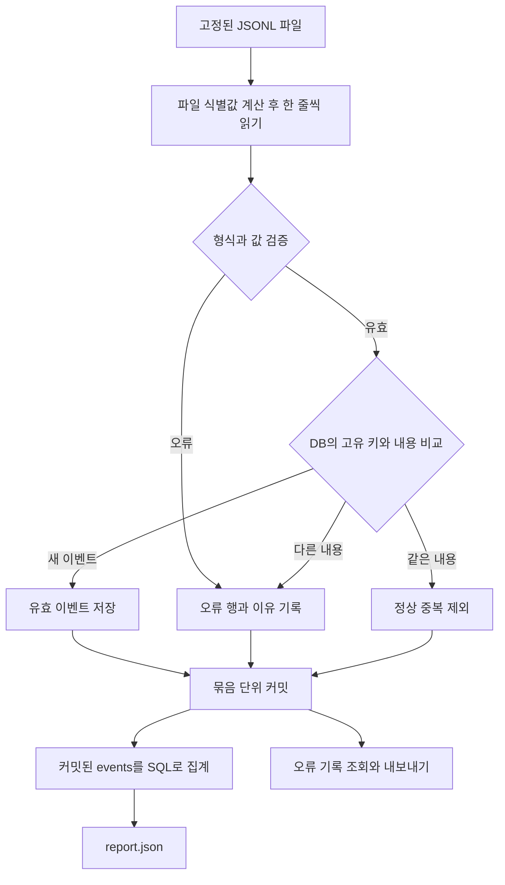

# 로그 재처리와 장애 복구를 위한 파이프라인 설계

설계 초안 v1 · 2026년 10월 14일

검색 로그를 수집하다가 프로그램이 종료되거나 동일한 파일이 다시 전달돼도 검색 건수와 서버 오류율이 중복 집계되지 않도록 만든다. Python 구현 에이전트는 아래 처리 규칙을 구현하고, 설계자는 정답이 정해진 입력과 프로세스 강제 종료 실험으로 결과를 검증한다.

첫 버전의 핵심 선택은 유효 이벤트를 SQLite에 한 번만 저장하고, 지표는 저장된 이벤트를 조회해 계산하는 것이다. 진행 위치를 별도로 저장하지 않고 원본 파일을 처음부터 다시 읽어 복구한다. 복구 구조가 단순해지는 대신 재실행 때 파일 전체를 읽는 비용을 받아들인다.

## 1 해결할 문제

검색 로그 파일에 정상 이벤트, 중복 이벤트, 잘못된 데이터가 함께 들어올 수 있다. 수집 프로그램은 일부 데이터를 저장한 뒤 종료될 수도 있다. 읽은 행마다 검색 건수를 증가시키는 방식에서는 같은 입력을 재처리할 때 건수가 증가한다. 진행 위치를 저장하는 방식에서도 데이터 저장과 진행 위치 갱신이 어긋나면 누락 또는 중복이 생길 수 있다.

이 프로젝트는 다음 세 가지를 해결한다.

- 같은 이벤트를 반복해서 받아도 서비스 지표가 증가하지 않는다.
- 저장 도중 프로세스가 종료돼도 같은 입력으로 재실행하면 정상 완료한 실행과 같은 최종 데이터와 지표에 도달한다.
- 잘못된 데이터와 ID 충돌은 정상 이벤트와 분리해 위치와 이유를 확인할 수 있다.

### 보장 범위

고정된 UTF-8 JSONL 파일을 순차적으로 처리하는 단일 수집 프로세스와 로컬 SQLite DB를 대상으로 한다. 재시도 동안 입력 파일의 내용과 순서가 유지되고, DB와 원본 파일이 보존돼야 한다. 프로세스 강제 종료 후 복구를 시험한다. 보고서는 생성 시점에 DB에 커밋된 이벤트를 대상으로 한다.

실시간 파일 변경, 여러 수집 프로세스의 동시 쓰기, 분산 시스템, 디스크 고장 및 전원 차단은 첫 버전의 검증 범위에 포함하지 않는다. 데이터가 도착한 순서와 다른 시간 순서로 정렬되는 현상은 시간별 조회로 처리하지만, 실시간 윈도와 watermark는 만들지 않는다.

## 2 입력과 데이터 규칙

입력은 JSONL이며 한 줄이 이벤트 하나다. 파일의 빈 줄은 오류 행으로 분류하고, 길이가 0인 빈 파일은 정상 입력으로 처리한다. 마지막 행은 줄바꿈이 없어도 처리한다. 입력 파일은 읽기만 한다.

```json
{"service":"web","event_id":"e001","event_time":"2026-10-14T00:00:00Z","query":"날씨","status_code":200}
```

| 필드 | 규칙 | 역할 |
| --- | --- | --- |
| service | 비어 있지 않은 문자열, 앞뒤 공백 거부 | 서비스별 ID 공간을 구분한다 |
| event_id | 비어 있지 않은 문자열, 앞뒤 공백 거부 | 서비스 안에서 이벤트를 식별한다 |
| event_time | 실제로 존재하는 UTC 날짜와 시간, YYYY-MM-DDTHH:MM:SSZ 형식 | 이벤트 발생 시각으로 시간대별 집계를 한다 |
| query | 비어 있지 않은 문자열 | 검색 이벤트 내용을 보존한다 |
| status_code | 100부터 599까지의 JSON 정수, true와 false 거부 | 500부터 599까지를 서버 오류로 센다 |

v1은 위 다섯 필드만 허용한다. 추가 필드, 필드 누락, JSON 객체가 아닌 값은 invalid_schema로 분류한다. 필드 자료형 또는 값이 잘못되면 invalid_value로 분류한다. 같은 객체 안에서 필드명이 반복된 JSON도 invalid_schema로 거부한다. 값을 임의로 보정하거나 문자열 숫자를 정수로 변환하지 않는다.

### 이벤트 식별과 충돌

이벤트의 고유 키는 (service, event_id)다. JSON 속성 순서와 JSON 바깥의 공백은 이벤트 내용에 포함하지 않는다. 파싱한 event_time, query, status_code를 기존 값과 비교한다. 문자열의 대소문자와 내용은 그대로 비교한다.

| 상황 | 처리 |
| --- | --- |
| 키가 처음 등장 | events에 저장 |
| 같은 키이고 세 내용 필드도 같음 | 정상 중복으로 분류하고 저장과 집계에 추가하지 않음 |
| 같은 키이고 내용 필드가 하나라도 다름 | 기존 이벤트 유지, 새 입력을 id_conflict로 기록 |

충돌 시 먼저 저장한 유효 이벤트를 유지한다. 따라서 서로 다른 내용을 가진 같은 ID의 입력 순서를 바꾸면 유지되는 내용과 지표가 달라질 수 있다. 모든 입력 순서에서 같은 지표를 보장한다고 주장하지 않는다. 순서 변경 불변성 테스트는 ID 충돌이 없는 데이터에 한정한다. ID 충돌의 자동 정정은 후속 설계 과제다.

## 3 처리 구조와 장애 복구



### 저장 구조

events 테이블은 service, event_id, event_time, query, status_code를 저장한다. service와 event_id를 복합 PRIMARY KEY로 두고 두 컬럼 모두 NOT NULL을 지정한다. 나머지 필드도 NOT NULL이며 status_code 범위 제약을 적용한다. 이벤트 검증은 애플리케이션에서 하고 DB 제약으로 핵심 조건을 다시 보호한다.

rejections 테이블은 input_sha256, line_no, reason, detail, raw_line을 저장한다. 원본 파일 바이트의 SHA-256과 1부터 시작하는 물리적 줄 번호를 복합 PRIMARY KEY로 두며 두 컬럼 모두 NOT NULL이다. 입력 파일의 경로는 식별 키로 쓰지 않는다. 동일한 바이트의 파일을 다른 이름으로 다시 전달해도 동일 입력의 재처리로 본다.

오류 기록의 reason은 malformed_json, invalid_schema, invalid_value, id_conflict 중 하나다. detail에 필드나 충돌한 키를 기록하고 raw_line에 입력 내용을 보존한다. 같은 원본의 같은 오류 행은 다시 기록하지 않는다. 파일 내용이 바뀌면 별도 입력으로 취급하므로 오류 발생 이력은 추가될 수 있다.

정상 중복 발생 건수는 실행별 요약에만 남긴다. 서비스 지표용 테이블, 별도 집계 카운터, 진행 위치 테이블은 만들지 않는다.

### 트랜잭션 경계

기본 batch_size는 입력 100줄이다. 오류와 중복 행도 배치의 입력 줄 수에 포함한다. 0 이하의 배치 크기는 거부한다. 마지막 100줄 미만의 묶음도 커밋한다.

각 묶음에 대해 명시적으로 트랜잭션을 시작하고 이벤트와 오류 기록을 처리한 뒤 함께 커밋한다. DB 오류 발생 시 현재 트랜잭션을 명시적으로 롤백하고 수집을 실패로 종료한다. 잘못된 입력 행은 격리 후 계속 처리하지만 DB 오류는 입력 오류로 숨기지 않는다. 앞서 커밋된 묶음은 유지된다.

커밋 전 종료된 묶음은 복구 시 다시 처리한다. 커밋 후 종료된 묶음은 DB의 고유 키와 기존 내용으로 중복을 구분한다. 오류 기록도 같은 DB 트랜잭션에서 저장하기 때문에 재시도 후 동일 오류 행이 누적되지 않도록 한다. SQLite의 트랜잭션 원자성에 기반한 구조이며 실제 애플리케이션 경계는 강제 종료 실험으로 확인한다. [SQLite 트랜잭션](https://www.sqlite.org/lang_transaction.html), [SQLite 원자적 커밋](https://www.sqlite.org/atomiccommit.html)

파일 식별값은 스트리밍으로 계산하고, 이후 파일을 다시 읽어 처리한다. 두 번 읽는 비용을 받아들인다. 처리 중 파일이 변하지 않는 입력 조건을 문서화한다. 오류 기록 파일을 DB와 동시에 직접 갱신하지 않고, DB의 rejections에서 별도 명령으로 내보낸다.

### 집계 규칙

- event_count는 events 테이블 행 수다.
- server_error_count는 저장된 이벤트 중 status_code가 500부터 599까지인 행 수다.
- server_error_rate_percent는 server_error_count / event_count * 100이다. 이벤트가 0개이면 0.0으로 출력한다. 소수점 6자리로 반올림한다.
- hourly는 UTC 발생 시각을 한 시간 단위로 묶은 전체 서비스의 이벤트 수와 서버 오류 수다.
- services는 서비스별 이벤트 수와 서버 오류 수다.
- hourly는 시간 오름차순, services는 서비스 이름 오름차순으로 출력한다.
- report.json에는 실행 시간, DB 경로, 중복 발견 건수 등 실행마다 달라지는 값을 넣지 않는다.

보고서에 필요한 조회들은 하나의 읽기 트랜잭션 안에서 같은 DB 상태를 기준으로 수행한다. 결과 파일은 임시 파일로 완성한 뒤 교체한다. DB에 저장된 이벤트가 기준이며 보고서는 다시 생성할 수 있다.

보고서와 오류 내보내기의 출력 경로가 DB 경로와 같으면 실패로 종료한다. 이 경로 충돌은 추가 테스트를 먼저 작성해 실패를 재현한 뒤 보호 로직을 구현한다.

### 실행별 요약과 서비스 지표의 구분

수집 성공 시 input_lines, inserted, duplicates, invalid, conflicts를 출력하고 합계가 input_lines와 일치해야 한다. 완료된 수집에 대해 유효한 새 이벤트는 inserted, 기존 내용과 같은 이벤트는 duplicates, 형식과 값 오류는 invalid, ID 내용 충돌은 conflicts로 센다.

같은 파일의 첫 실행과 두 번째 실행에서 inserted와 duplicates는 달라질 수 있다. 반면 events의 내용과 report.json은 같아야 한다. 종료된 프로세스는 성공 요약을 출력하지 않는다. 실행 도중의 진단 로그와 최종 성공 요약을 구분한다.

## 4 결과물

구현 후 결과물은 다음과 같다.

| 결과물 | 사용 목적 |
| --- | --- |
| Python CLI 코드 | 로그 수집, 지표 조회, 오류 기록 내보내기 |
| SQLite DB | 유효 이벤트와 오류 발생 위치 보존 |
| report.json | 전체 건수, 서버 오류율, 시간별 및 서비스별 지표 |
| rejections.jsonl | 오류 줄 번호, 이유, 원문 확인 |
| 실행별 요약 | 이번 실행에서 새로 저장하거나 제외한 건수 확인 |
| 테스트 입력과 기대 결과 | 정확성을 독립적으로 비교할 기준 |
| 장애 실험 기록 | 종료 시점, 프로세스 상태, 재실행 전후 DB와 보고서 비교 |
| README와 설계 판단 기록 | 실행 방법, 선택 근거, 검증 범위, 남은 한계 설명 |

CLI 인터페이스는 다음 형태로 구현한다. 아래는 예정된 인터페이스다.

```text
python -m replaylog ingest fixtures/golden-12.jsonl --db work/events.db --batch-size 100
python -m replaylog report --db work/events.db --out work/report.json
python -m replaylog rejects --db work/events.db --out work/rejections.jsonl
```

데이터 오류를 기록하면서 파일 끝까지 처리한 경우 ingest는 정상 완료로 종료한다. 파일 열기 실패, UTF-8 디코딩 실패, DB 오류는 실패로 종료하며 오류 이유를 출력한다. UTF-8 및 DB 오류 전의 커밋된 배치는 남는다. 명령행 인자 오류도 정상 완료로 취급하지 않는다.

### 12줄 예제의 기대 결과

fixtures/golden-12.jsonl은 다음 순서의 입력이다.

| 줄 | 내용 | 분류 |
| --- | --- | --- |
| 1 | web e001, 00시, 200 | 새 이벤트 |
| 2 | web e002, 00시, 500 | 새 이벤트 |
| 3 | web e003, 00시, 200 | 새 이벤트 |
| 4 | web e004, 01시, 503 | 새 이벤트 |
| 5 | mobile e001, 01시, 200 | 새 이벤트, 다른 서비스의 같은 ID |
| 6 | 2번과 내용이 같은 이벤트 | 정상 중복 |
| 7 | 3번과 내용이 같은 이벤트 | 정상 중복 |
| 8 | 1번과 같은 키, status_code만 500 | ID 충돌 |
| 9 | 깨진 JSON | 형식 오류 |
| 10 | event_time 누락 | 스키마 오류 |
| 11 | status_code가 999 | 값 오류 |
| 12 | 2026년 2월 30일 | 값 오류 |

첫 실행의 기대 요약은 input_lines=12, inserted=5, duplicates=2, invalid=4, conflicts=1이다. 같은 DB에 같은 파일을 다시 수집하면 inserted=0, duplicates=7, invalid=4, conflicts=1이다. 두 실행 후 DB의 유효 이벤트는 5개, 오류 기록은 5개다.

기대 지표는 이벤트 5개, 서버 오류 2개, 서버 오류율 40.0%다. UTC 00시에는 이벤트 3개와 서버 오류 1개, 01시에는 이벤트 2개와 서버 오류 1개다. mobile은 이벤트 1개와 서버 오류 0개, web은 이벤트 4개와 서버 오류 2개다. 예제 입력과 기대 JSON은 이 문서 옆 fixtures 디렉터리에 있다. 기대 결과는 테스트 기준이며 실행 측정값이 아니다.

## 5 테스트 방법과 통과 기준

### 기준을 만드는 방법

설계자는 작은 입력의 기대 행과 지표를 직접 계산한다. 실제 구현의 집계 함수를 호출해 기대 결과를 만들지 않는다. 정상 실행과 장애 실행의 결과가 같다는 비교에 더해, 둘 모두 손으로 정한 기대 결과와 일치해야 한다.

각 테스트는 새 DB에서 시작하며 독립된 작업 디렉터리를 사용한다. 동일 DB의 재처리를 검증하는 테스트 안에서만 DB를 재사용한다. 비교 대상은 service, event_id로 정렬한 유효 이벤트, input_sha256과 line_no로 정렬한 오류 기록, 파싱한 보고서 JSON이다. SQLite 파일 바이트와 실행별 요약 전체를 일치 조건으로 삼지 않는다.

| 테스트 | 절차 | 통과 기준 |
| --- | --- | --- |
| T01 정상과 오류 분리 | 12줄 예제를 새 DB에 수집 | 유효 이벤트 5개, 오류 기록 5개, 기대 지표와 일치 |
| T02 재실행 | 같은 DB에 같은 파일을 다시 수집 | 이벤트 내용, 오류 기록, 보고서가 T01과 동일 |
| T03 서비스별 키 | web e001과 mobile e001을 수집 | 서로 다른 이벤트 2개로 저장 |
| T04 JSON 표현 차이 | 속성 순서와 바깥 공백만 다른 같은 이벤트 수집 | 같은 내용의 중복으로 분류 |
| T05 ID 충돌 | 같은 키에 다른 status_code 입력 | 기존 값 유지, id_conflict 기록, 정상 중복과 구분 |
| T06 입력 검증 | 깨진 JSON, 누락, 배열, 추가 필드, 중복 필드명, 문자열 상태 코드, boolean 상태 코드, 날짜 오류, 빈 줄 입력 | 규칙에 맞는 오류 이유로 분리, 정상 이벤트에 포함되지 않음 |
| T07 빈 입력 | 0바이트 파일 수집 후 조회 | 이벤트 0개, 오류율 0.0, 빈 hourly와 services 배열 |
| T08 배치 경계 | 12줄 예제를 batch_size 1, 4, 100으로 각각 수집 | 최종 데이터와 보고서가 모두 기대 결과와 동일 |
| T09 커밋 전 강제 종료 | 배치 2의 모든 행 처리 후 커밋 직전 종료 | 종료 직후 커밋된 이벤트 4개와 오류 0개, 재실행 후 T01과 동일 |
| T10 커밋 후 강제 종료 | 배치 2 커밋 직후 종료 | 종료 직후 이벤트 5개와 오류 1개, 재실행 후 T01과 동일 |
| T11 순서 변경 | 충돌을 제외한 유효 이벤트와 정상 중복을 섞어 수집 | 같은 이벤트 집합과 서비스 지표, 오류 위치 이력 비교는 제외 |
| T12 실패 전달 | 존재하지 않는 입력 또는 쓰기 불가능한 DB 경로로 실행 | 실패 종료, 원인 출력, 성공으로 보고하지 않음 |

### 프로세스 강제 종료 실험

Linux 또는 WSL에서 자식 수집 프로세스를 실행한다. 테스트 전용 훅은 특정 배치의 before_commit 또는 after_commit 시점에 도달했음을 부모 테스트에 알리고 대기한다. 부모가 이 신호를 받은 뒤 SIGKILL로 자식을 종료한다. 임의 시간만 기다렸다가 종료하는 방식은 종료 위치가 불확실하므로 쓰지 않는다.

T09와 T10은 batch_size=4, target_batch=2를 사용한다. 1번 배치에는 줄 1~4, 2번 배치에는 줄 5~8이 들어간다. before_commit에서는 2번 배치가 커밋되지 않은 상태로, after_commit에서는 2번 배치가 커밋된 상태로 종료한다. 테스트 훅은 일반 실행에서는 활성화하지 않는다.

부모는 강제 종료 상태를 확인한 뒤 DB를 다시 열어 중간 상태를 확인한다. 이후 테스트 훅 없이 같은 파일을 재수집하고 보고서와 오류 기록을 내보낸다. 새 DB에서 정상 완료한 실행과 비교하고, 기대 결과 파일과도 비교한다. 마지막으로 PRAGMA integrity_check 결과가 ok인지 기록한다.

두 실험을 각각 새 DB에서 3회 반복한다. 예외를 던진 뒤 정상 롤백하는 단위 테스트는 실제 프로세스 강제 종료 실험을 대체하지 않는다. 이 시험 결과를 전원 차단이나 모든 운영 장애의 검증으로 확대하지 않는다.

### 남길 증거

각 실험에 입력 파일 SHA-256, 코드 commit, Python과 SQLite 버전, OS, journal_mode, synchronous 설정, 배치 크기, 종료 지점, 종료 상태, 재실행 종료 상태, 기대값과 실제값 비교를 기록한다. 실제로 통과한 항목만 PASS로 표시하고 실패한 경우 입력과 DB 조회 결과를 보존한다.

성능 측정은 필수 통과 기준 뒤에 진행한다. 동일한 데이터와 환경에서 batch_size 1, 100, 1000의 처리 시간과 최종 결과를 비교할 수 있다. 배치 크기를 키워 처리량을 높이면 커밋 전 종료 시 다시 처리할 입력도 늘어난다. 성능 수치는 실행한 환경과 입력 건수를 함께 제시한다.

## 6 설계 판단을 보여줄 기록

| 선택 | 비교할 대안 | 선택 근거와 비용 |
| --- | --- | --- |
| DB 고유 키로 중복 관리 | 메모리 set | 재시작 후에도 중복 여부를 유지한다. DB 조회와 쓰기 비용이 든다 |
| 이벤트 저장 후 SQL 집계 | 읽을 때 별도 카운터 증가 | 재처리 횟수와 지표를 분리한다. 조회 때 집계 비용이 든다 |
| 원본 전체 재처리 | 파일 진행 위치 저장 | 저장 상태와 진행 위치의 어긋남을 없앤다. 파일 전체를 다시 읽는다 |
| 먼저 저장한 이벤트 유지와 충돌 기록 | 덮어쓰기 또는 무조건 중복 취급 | 조용한 데이터 변경을 막고 조사할 근거를 남긴다. 먼저 도착한 값이 옳다는 보장은 없다 |
| 오류를 DB에 기록한 후 내보내기 | DB와 오류 파일을 함께 갱신 | 복구 기준을 한 저장소로 모은다. 내보내기 명령이 추가된다 |
| 묶음 단위 저장 | 한 행마다 커밋 | 커밋 횟수를 줄인다. 미완료 배치를 다시 처리하는 비용을 검증해야 한다 |

대안은 설계 후보로 기록한다. 구현하거나 측정하지 않은 대안을 실제로 실험한 것처럼 쓰지 않는다. 포트폴리오는 문제 정의, 선택한 규칙, 대안의 비용, 장애 실험 결과, 남은 한계 순서로 구성한다. 설계자와 AI 에이전트의 기여 범위를 구분한다.

## 7 구현 에이전트에게 넘길 범위

먼저 입력 검증과 DB 저장, 다음으로 조회와 오류 내보내기, 마지막으로 재실행과 강제 종료 테스트를 구현한다. v1의 필수 완료 조건은 T01~T12와 실제 Linux 또는 WSL 강제 종료 실험의 통과다. 테스트 결과가 준비되기 전에는 구현 완료와 검증 완료를 구분한다.

웹 UI, 인증, 클라우드 배포, Kafka, 분산 처리, 자동 오류 정정, 별도 진행 위치 저장은 후속 확장으로 둔다. 구현 중 규칙 변경이 필요하면 기대 결과와 테스트 기준을 함께 검토하고 설계 판단 기록에 남긴다.

### 기술 근거

- [SQLite 테이블과 제약 조건](https://www.sqlite.org/lang_createtable.html)
- [SQLite 고유 키 충돌 처리](https://sqlite.org/lang_upsert.html)
- [SQLite 트랜잭션](https://www.sqlite.org/lang_transaction.html)
- [SQLite 원자적 커밋](https://www.sqlite.org/atomiccommit.html)
- [Python SQLite 인터페이스](https://docs.python.org/3/library/sqlite3.html)
- [대상 데이터 플랫폼 엔지니어 채용 공고](https://www.wanted.co.kr/wd/373625)
